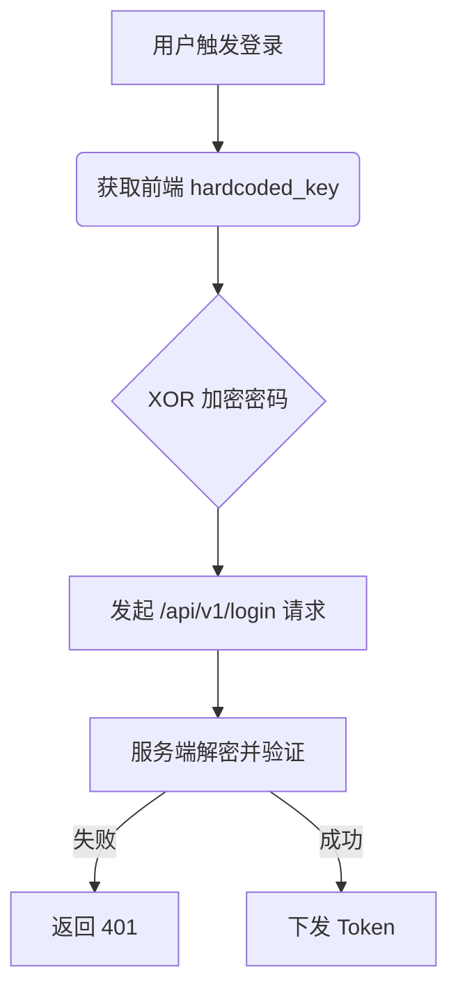

# 自动化安全审计报告

## 📌 核心结论
目标代码中存在**硬编码的 XOR 加密密钥**，且前端请求未进行数据完整性校验，存在逻辑漏洞风险。

## 🗺️ 逻辑流图


🔗 证据溯源

· [STATIC] 静态资产发现：在 sample_code.js 第 15 行发现硬编码字符串 secret_key_123。
· [DYNAMIC] 动态流量捕获：通过 Playwright 拦截请求，发现 Payload 结构为 {"user":"admin", "pwd":"encrypted_str"}。
· [REVERSE] 核心伪代码还原：解密函数使用了简单的单字节 XOR 循环。

🛠️ 最小验证脚本 (PoC)

```bash
# 验证硬编码密钥导致的越权/伪造风险
curl -X POST https://api.example.com/v1/login \
  -H "Content-Type: application/json" \
  -d '{"user":"admin", "pwd":"XOR_ENCODED_PAYLOAD"}'

# 预期响应：如果服务端未做二次校验，将返回有效的 Token
```

⚠️ 风险提示

当前分析仅覆盖了前端静态代码与抓包层面。服务端是否对重放攻击做了防范，需要进一步动态测试。
