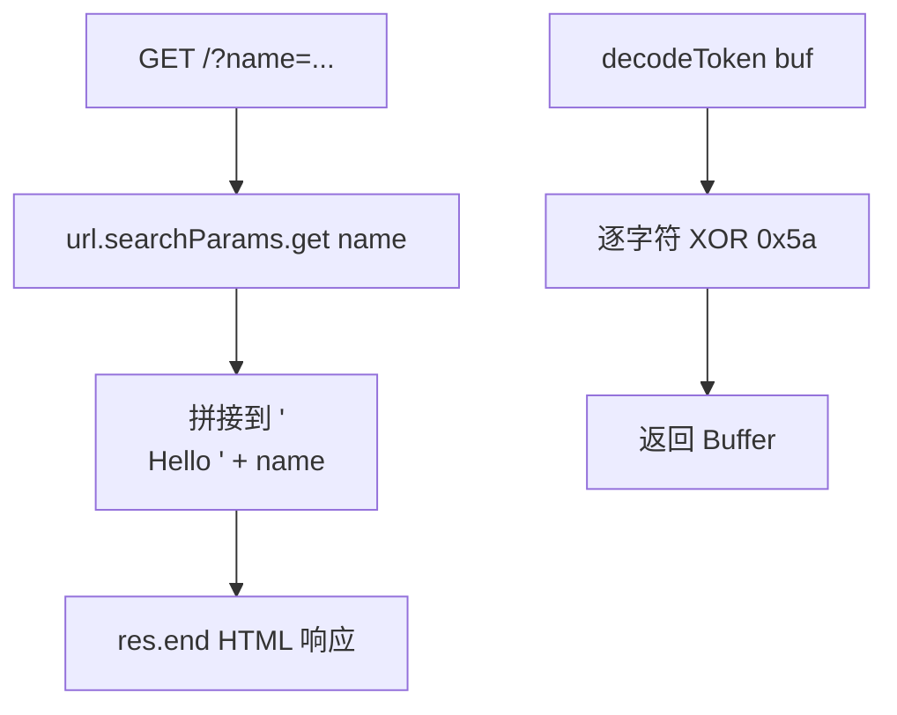

# 审计报告（示例输出）

> 目标：`examples/sample_code.js`（训练用样本，非真实系统）

## 1. 核心结论

样本存在两处问题：(a) `handleRequest` 存在反射型 XSS（`name` 参数未转义直接回写 HTML）；(b) `decodeToken` 所谓“加密”是硬编码 XOR，不构成任何真实保护。

## 2. 逻辑流图



## 3. 证据溯源

- 第 4 行：`_0x2a7b(a, b) { return a ^ b; }`
- 第 6 行：`const SECRET_KEY = 0x5a;`
- 第 10–13 行：`handleRequest` 读取 `name` 并直接拼到 `res.end`

## 4. 最小验证 PoC（仅在已授权目标上运行）

```bash
# 反射型 XSS 验证（训练样本本地环境）
curl "http://localhost:3000/?name=<script>alert(document.domain)</script>"
# 期望：响应回显未转义的 <script> 标签，说明存在反射型 XSS
```

```js
// “加密”可逆性验证
const { decodeToken, SECRET_KEY } = require('./sample_code.js');
// 因为 key 硬编码在源码里，任何人拿到源码即可逆
console.log(SECRET_KEY); // 0x5a
```

## 5. 架构优化建议

- `handleRequest`：对 `name` 做 HTML 转义（或用自动转义的模板引擎），并加 CSP 响应头。
- `decodeToken`：如确需保护，改用 `crypto.scrypt` 派生 + 随机 per-user salt + AES-GCM，不要自研 XOR。
- `SECRET_KEY`：从环境变量读取，不要硬编码在源码中。

## 6. 风险提示

本报告中的 PoC 仅用于对训练样本的本地验证。对任何第三方系统运行 PoC 前，必须已获得书面授权。
