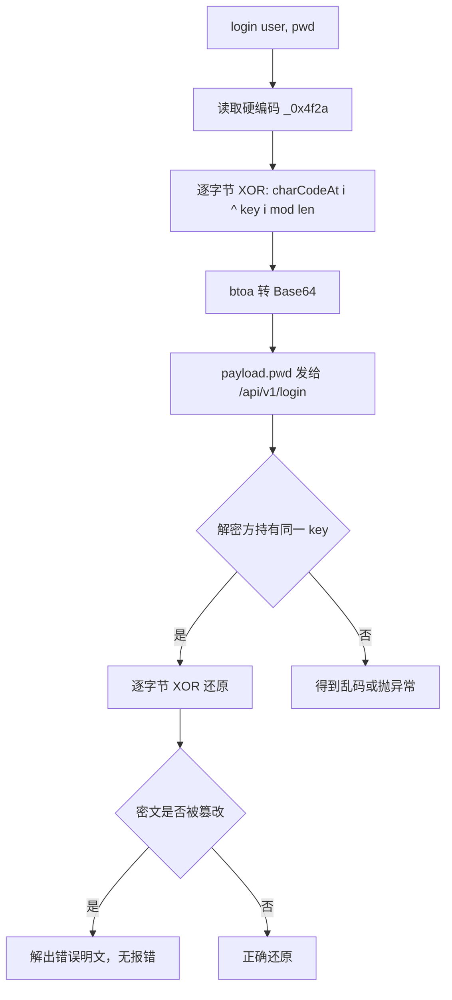

# 审计报告示例

> 针对 [`sample_code.js`](sample_code.js) 的一次完整静态审查输出。展示六段式报告的格式，不是真实漏洞。

---

授权依据：用户自有开源项目（MIT） | 审计范围：examples/sample_code.js 单文件 | 时间窗：2026-11-09 | 审计人：本地 Agent 会话

## 📌 审计结论

匿名 IIFE 用硬编码 XOR 密钥（`var _0x4f2a = "secret_key_123"`，第 5 行）做对称混淆，密钥与算法同处一份源码，且流密码无完整性校验；`btoa` 包装还会在非 Latin-1 字符上抛异常。最高风险：**中**（密钥不可保密，密文可被伪造 / 位翻转）。

## 🗺️ 逻辑流图



## 🔗 证据溯源

```
[STATIC] 硬编码密钥：var _0x4f2a = "secret_key_123"
  - 位置：sample_code.js:5
[STATIC] 加密函数 _0xe1b2(str)：返回 btoa(result)
  - 位置：sample_code.js:6-13
[REVERSE] XOR 核心：str.charCodeAt(i) ^ _0x4f2a.charCodeAt(i % _0x4f2a.length)
  - 位置：sample_code.js:10
[REVERSE] 无 HMAC / 无 nonce / 无 IV：函数体内无相关调用
  - 位置：sample_code.js:6-13
[HTTP] 无实际网络调用；fetch 只出现在第 21 行注释里
  - 位置：sample_code.js:21（注释，不计为可达路径）
```

## 缺陷清单

| 编号 | 缺陷 | 等级 | 触发条件 | 影响面 | 置信度 | 证据 |
|---|---|---|---|---|---|---|
| F1 | 硬编码 XOR 密钥 | 中 | 读源码或解包 bundle | 任何拿到代码的人可解密 / 伪造密文 | 高 | sample_code.js:5 |
| F2 | 流密码无完整性校验 | 低 | 已知密文且可修改密文 | 位翻转可定向篡改明文且不报错 | 中 | sample_code.js:6-13 |
| F3 | `btoa` 仅接受 Latin-1 字符 | 低 | 明文含中文、emoji 等非 Latin-1 字符 | 加密路径抛 `InvalidCharacterError`，登录失败 | 高 | sample_code.js:12 |

## 🛠️ 最小验证脚本

```python
# verify_xor_key.py — 证明密钥硬编码可被提取
# 运行（在仓库根目录）：python examples/verify_xor_key.py
# 只读本地文件，不发起网络请求，不含破坏性载荷
import re
import pathlib

SRC = pathlib.Path(__file__).with_name("sample_code.js")
src = SRC.read_text(encoding="utf-8")

m = re.search(r'var\s+_0x4f2a\s*=\s*"([^"]+)"', src)
assert m, "密钥变量未找到：样本结构已变，需重新定位"

key = m.group(1)
print(f"[+] extracted key: {key!r} (len={len(key)})")
print(f"[+] 行号：{src[:m.start()].count(chr(10)) + 1}")
print("[+] 判定：硬编码密钥可从源码直接提取 — 验证通过")
```

预期输出：

```text
[+] extracted key: 'secret_key_123' (len=14)
[+] 行号：5
[+] 判定：硬编码密钥可从源码直接提取 — 验证通过
```

## 修复建议与复测

| 编号 | 修复方向 | 验收标准 |
|---|---|---|
| F1 | 密钥移到服务端，客户端只持短期令牌；或改用 Web Crypto 的 AES-GCM 并由 KMS 派钥 | 解包 bundle 不再含可用密钥；伪造密文被拒 |
| F2 | 改用带认证的加密（AES-GCM / ChaCha20-Poly1305），密文附 tag | 篡改任一字节解密即失败 |
| F3 | 先用 `TextEncoder` 取字节再加密，不要直接 `btoa` 字符串 | 中文 / emoji 明文加密不再抛异常 |

**复测步骤**：修复后在 bundle 上 grep `_0x4f2a` 应零命中；对密文翻转 1 字节后解密应抛 `auth tag mismatch`；用含中文的口令跑一次加密，应正常返回密文。

---

### ⚠️ 未覆盖项与风险缺口

- 本审查仅覆盖静态源码，未做动态抓包（样本里没有真实网络调用，fetch 只存在于注释）。
- 未评估服务端是否复用同一密钥——若复用，影响面会从「中」升到「高」，需单独审查服务端配置。
- `_0xe1b2` 是混淆命名，本报告按行为而非名字定性；若真实项目中还有同名变形函数，需按调用图复核。
- 结论适用于该单文件样本；真实项目应连同打包配置、环境变量加载、CI 密钥扫描一并审查。

[compliance: N/A — 非 LLM 目标]
