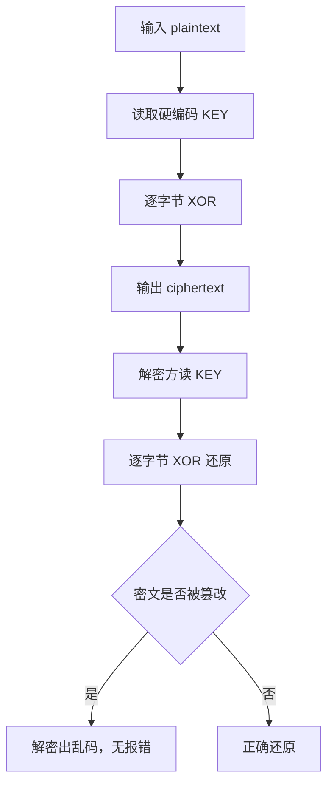

# 审计报告示例

> 针对 [`sample_code.js`](sample_code.js) 的一次完整静态审查输出。展示六段式报告的格式，不是真实漏洞。

---

授权依据：用户自有开源项目（MIT） | 审计范围：examples/sample_code.js 单文件 | 时间窗：2026-11-09 | 审计人：本地 Agent 会话

## 📌 审计结论

样本使用硬编码 XOR 密钥做对称加密，密钥直接写在源码第 5 行，且流密码无完整性校验。最高风险：**中**（密钥不可保密，密文可被伪造/位翻转）。

## 🗺️ 逻辑流图



## 🔗 证据溯源

```
[STATIC] 硬编码密钥：const KEY = "demo-secret-key"
  - 位置：sample_code.js:5
[STATIC] 加密逻辑：逐字节 (charCode ^ KEY.charCodeAt(i % KEY.length))
  - 位置：sample_code.js:12-18
[REVERSE] 无 HMAC / 无 nonce / 无 IV 拼接
  - 位置：encrypt 函数全文（第 12-18 行）
[HTTP] 无网络调用（grep fetch/XMLHttpRequest 零命中）
  - 位置：全文
```

## 缺陷清单

| 编号 | 缺陷 | 等级 | 触发条件 | 影响面 | 置信度 | 证据 |
|---|---|---|---|---|---|---|
| F1 | 硬编码 XOR 密钥 | 中 | 解包 bundle 或读源码 | 任何拿到代码的人可解密/伪造密文 | 高 | sample_code.js:5 |
| F2 | 流密码无完整性校验 | 低 | 已知密文 + 可修改密文 | 位翻转攻击可篡改明文且不报错 | 中 | encrypt 函数全文 |

## 🛠️ 最小验证脚本

```python
# verify_xor_key.py — 证明密钥硬编码可被提取
# 运行：python verify_xor_key.py
# 不发起网络请求，不含破坏性载荷
import re, pathlib

src = pathlib.Path("sample_code.js").read_text(encoding="utf-8")
m = re.search(r'const\s+KEY\s*=\s*[\"\']([^\"\']+)[\"\']', src)
assert m, "KEY not found"
key = m.group(1)
print(f"[+] extracted key: {key!r} (len={len(key)})")
print(f"[+] 判定：硬编码密钥可从源码直接提取 — 验证通过")
```

## 修复建议与复测

| 编号 | 修复方向 | 验收标准 |
|---|---|---|
| F1 | 密钥移至服务端，客户端持短期令牌；或改用 Web Crypto API 的 AES-GCM 并由 KMS 派钥 | 解包 bundle 不再含可用密钥；伪造密文被拒 |
| F2 | 改用带认证的加密算法（AES-GCM / ChaCha20-Poly1305），密文附带 tag | 篡改任一字节解密即失败 |

**复测步骤**：在修复后的 bundle 上 grep `KEY =` 应零命中；对密文翻转 1 字节后解密应抛 `auth tag mismatch`。

---

### ⚠️ 未覆盖项与风险缺口

- 本审查仅覆盖静态源码，未做动态抓包（样本无网络调用）。
- 未评估生产环境的密钥管理实践——如果该密钥在服务端也被复用，影响面会从「中」升到「高」，需单独审查服务端配置。
- 结论适用于该单文件样本；真实项目应连同打包配置、环境变量加载、CI 密钥扫描一并审查。

[compliance: N/A — 非 LLM 目标]
