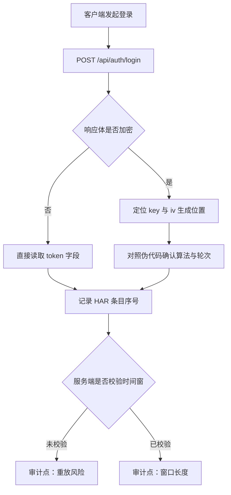

# 审计报告规范

## 1. 六段式结构

先结论，再图，再证据，再缺陷，再脚本，最后修复。顺序固定，便于评审方按段落评审。

### 第一段 · 核心结论

业务逻辑一句话 + 最高风险等级。不超过三行。

> 客户端以 `sign = md5(body + ts + 硬编码 salt)` 生成请求签名，salt 硬编码在主进程第 3 个混淆模块内。最高风险：中（客户端侧密钥不可保密，服务端缺少重放防护）。

### 第二段 · 逻辑流图

Mermaid 流程图，覆盖请求、响应与关键判断路径。节点用中文，标出审计点。



### 第三段 · 证据溯源

按证据类型分条，每条带具体位置：文件路径加行号、二进制偏移、函数名、HAR 条目序号。

```
[STATIC] 静态资产发现：Electron 应用，asar 内含 3 个主进程模块，版本 2.4.1
  - 位置：app.asar -> main/index.js:118
[DYNAMIC] 动态流量捕获：登录请求含 sign 与 ts 自定义头，响应为明文 JSON
  - 位置：HAR entry #7，POST /api/auth/login
[REVERSE] 核心伪代码还原：签名函数拼接 body 与 ts 后做 MD5，与抓包字段一致
  - 位置：FUN_00401a20
```

| 标记 | 含义 |
|---|---|
| `[STATIC]` | 静态资产侦察结论 |
| `[DYNAMIC]` | 流量捕获或运行时观察结论 |
| `[REVERSE]` | 反编译或伪代码还原结论 |
| `[HTTP]` | 单条 HTTP 证据：方法、路径、参数、状态码、响应长度；无 HAR 时替代「HAR 条目序号」 |
| `[证据缺失]` | 笔记中无支撑证据，需进一步侦察，不得补全推论 |

需外部依据时追加 `[DOC]`，注明文档来源与版本。

### 第四段 · 缺陷清单

按严重程度排序，表格呈现：

| 编号 | 缺陷 | 等级 | 触发条件 | 影响面 | 置信度 | 证据 |
|---|---|---|---|---|---|---|
| F1 | 客户端硬编码签名密钥 | 中 | 解包 asar 即可读取 | 可伪造签名，受服务端限流约束 | 高 | [STATIC] main/index.js:118 |
| F2 | 服务端未校验时间窗 | 高 | 重放历史请求 | 可重放非幂等操作 | 中 | [DYNAMIC] HAR #7 |

置信度只填三档：高（已复现或伪代码直接可见）、中（多路证据一致但未复现）、低（单一线索推断）。

### 第五段 · 验证脚本

用于证明缺陷存在的最小脚本。要求：

- 只做验证，不做武器化；**不包含破坏性攻击载荷**，不提供批量利用、绕过保护或横向移动能力。
- 单文件、少依赖、能独立跑通。
- 注明运行环境（语言版本、依赖、目标所在授权环境）。
- 含清理步骤：临时文件、抓包产物、日志如何删除。
- 不硬编码真实凭据、密钥或他人账号；用占位符，运行时由环境变量注入。
- 判定必须能区分「正常空结果」与「目标报错」：同时校验 HTTP 状态码与响应特征，只数结果条数会把 500 错误页误判为空结果；对偶发 5xx 重试一次并记录稳定性。

示例骨架（验证签名可伪造，不含任何网络请求）：

```python
import hashlib, os

def sign(body: str, ts: str, salt: str) -> str:
    return hashlib.md5((body + ts + salt).encode()).hexdigest()

if __name__ == "__main__":
    print(sign(os.environ["BODY"], os.environ["TS"], os.environ["SALT"]))
```

### 第六段 · 修复建议与复测

逐条对应缺陷，给方向与验收标准，不给整段替换代码。

| 编号 | 修复方向 | 验收标准 |
|---|---|---|
| F1 | 签名密钥移至服务端，客户端改为持有短期令牌 | 解包客户端不再含可用密钥；伪造签名请求被拒 |
| F2 | 服务端校验时间窗并引入 nonce 去重 | 重放同一请求返回 409；窗口收敛至 300 秒内 |

复测步骤写清：复测环境、输入、期望结果、判定方式。

## 2. 合规映射（条件式，默认不启用）

只有**目标本身是 LLM / Agent 应用**时才做映射：出现 prompt 模板、tool/function schema、向量库或检索配置、agent 编排文件，或依赖里命中 `openai` / `anthropic` / `langchain` / `llama_index` / `mcp`。非 LLM 目标的缺陷清单末尾统一写一行 `[compliance: N/A — 非 LLM 目标]`，**不得为了格式完整硬套标签**。

命中时，在缺陷清单表格右侧加一列「合规项」，只能从下表取：

| 观察到的缺陷类型 | 标签（编号已钉死年份） |
|---|---|
| 提示注入、越权指令；含间接注入（工具返回、文档、日志、文件名被当作指令） | `[OWASP-LLM01:2025 Prompt Injection]` |
| 模型或应用输出敏感数据：PII、凭据、他人上下文 | `[OWASP-LLM02:2025 Sensitive Information Disclosure]` |
| 系统提示词可被提取，或其中硬编码了密钥与过滤逻辑 | `[OWASP-LLM07:2025 System Prompt Leakage]` |
| 工具权限过大、缺少人工确认、可自主产生副作用 | `[OWASP-LLM06:2025 Excessive Agency]` |
| 模型输出未校验即进入 HTML / SQL / Shell / 模板 / 下游 API | `[OWASP-LLM05:2025 Improper Output Handling]` |
| RAG 检索越权、向量库未按租户隔离、投毒文档可入库 | `[OWASP-LLM08:2025 Vector and Embedding Weaknesses]` |
| 模型权重、适配器、插件、MCP server 未固定版本或未校验来源 | `[OWASP-LLM03:2025 Supply Chain]` |

规则：

1. **一个标签必须能指回一条证据**（文件+行、抓包序号、命令输出）。指不回去就不挂标签，只保留技术结论。
2. **编号必须带年份**。2023 版与 2025 版编号不同：2023 的 LLM06 是 Sensitive Information Disclosure，2025 把该风险移到 LLM02、LLM06 改为 Excessive Agency。混用即错，宁可不写。
3. 拿不准条目时写 `未映射（标准条目待核）`，**禁止猜编号**。NIST AI RMF 尤其容易贴错：MEASURE 2.6 讲的是「系统被定期评估安全风险、残余风险不超容忍度、可安全失效」，不是工具调用；代理权限与工具面风险更接近 MEASURE 2.7（安全与韧性被评估并记录）。
4. OWASP LLM Top 10 是威胁建模词汇，不是控制框架、不是合规徽章。报告里不得出现「已符合 OWASP」这类结论，只能写「本条对应 LLM0x，证据见 …」。
5. 映射不改变分级：严重度仍按第 3 节判据，合规标签只是附加索引。

## 3. 严重程度判据

| 等级 | 判定依据 | 典型情形 |
|---|---|---|
| 严重 | 无需前置权限即可远程利用，影响核心数据或全量用户 | 未授权访问接口、远程代码执行 |
| 高 | 需要低权限账户或一次用户交互，影响单用户敏感数据 | 越权读他人数据、令牌泄露可长期利用 |
| 中 | 需要本地条件或较高门槛，影响范围可控 | 客户端硬编码密钥、日志含敏感字段 |
| 低 | 信息泄露为主，难以直接转化为危害 | 版本号暴露、详细错误堆栈、调试开关残留 |

等级不只看技术影响，还要看可达性：静态可达但未验证利用条件的，按下一档处理并注明。

## 4. 报告头与报告尾

**报告头**：每份报告开头附一行，与 `audit_notes.md` 一致：

```
授权依据：{项目名 / 审批编号 / 授权方} | 审计范围：{具体目标与动作} | 时间窗：{起止日期} | 审计人：{角色}
```

**报告尾 · ⚠️ 风险提示**：以「未覆盖项与风险缺口」一段收尾，逐条写清哪些问题未验证、对结论可信度的影响，并汇总潜在业务风险。审计方据此判断结论的适用边界，这一段不得省略。

## 5. 缺失信息的写法

证据不足时直接写缺口，不留白也不猜：

```
未覆盖项：服务端是否二次校验设备指纹，未验证（无授权测试账户）。
影响：F2 的实际可利用性可能低于评估值，结论适用于当前账号类型。
```

## 6. 篇幅控制

- 结论段不超过 3 行。
- 证据段按类型分组，每组 1 到 3 条，超出部分折叠为附录。
- 不写背景科普，不解释通用概念。读者按「能读懂伪代码的评审人」设定。
